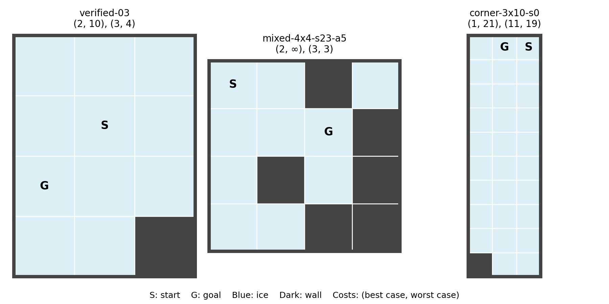
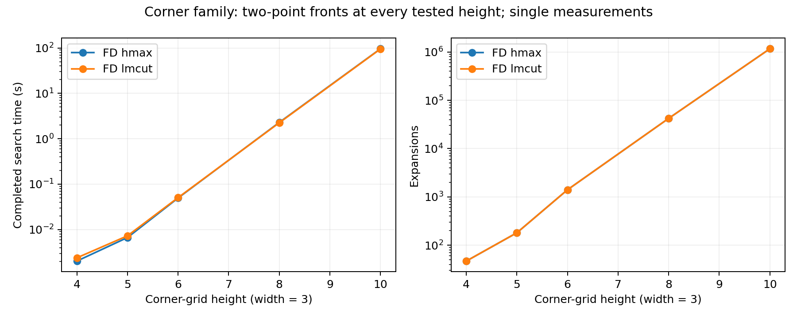

# FrozenLake benchmark pilot

The pilot found a scalable family with two-point Pareto fronts and meaningful
search difficulty, plus a small mixed strong/strong-cyclic example. It did not
find fronts with three or more cost pairs. The results support a more deliberate
benchmark generator, rather than simply using larger random maps.

## Scope and validation

The fixed pilot contains 19 candidates selected before timing: three exact
examples, five increasing-height corner grids, three staggered-wall grids,
six seeded random wall/pit grids and two controls. A subsequent adaptive
follow-up contains four wider corners and one mixed-front map. Keep these
phases separate when interpreting selection bias.

All instances use the original ICAPS FrozenLake domain byte for byte, with
ordinary rectangular-grid adjacency and unit action costs. No domain or policy
semantics were changed. Inputs, full layouts, generation seeds/parameters and
source hashes are committed separately from ICAPS in
`benchmarks/journal_tradeoffs/`. These remain pilot candidates; the final
journal benchmark is not yet selected.

Both direct FD/hmax and FD/LM-cut ran with `PYTHONHASHSEED=0`, 600 seconds/job,
6,000,000 KB virtual memory/job and at most four workers. The phases ran
sequentially. Planner source was fixed at `a3df4da`. There is one measurement
per case/configuration: timing differences are not repeatable-speedup claims.

| Phase | Instances | Jobs completed | Solvable instances | Non-singleton fronts |
| --- | ---: | ---: | ---: | ---: |
| Fixed pilot | 19 | 38/38 | 17 | 8 |
| Adaptive follow-up | 5 | 10/10 | 5 | 1 |

Both heuristics agreed on every completed front. All **62 emitted policies**
passed original-PDDL replay, including agreement on best/worst costs. Seven
fixed-pilot fronts were independently exhaustive under the 200,000-assignment
limit. Three supplementary fronts were independently exhaustive, explicitly
raising that limit to 2,000,000 for the 4×4 corner. Larger complete fronts rely
on BOAND optimality, rather than an independent exhaustive proof.

The fixed-pilot barrier and `random-5x6-s0` completed with no policies. There
were no timeouts, memory failures, malformed statistics or replay mismatches.
Peak per-process memory was not recorded by the BOAND runner, so this pilot
does not quantify memory scaling. Configured virtual-memory limits are not
measurements of actual consumption.

## Quality findings

Eight of the 17 solvable fixed candidates have two Pareto pairs (**47.1%**).
All those pairs correspond to strong policies. The adaptive mixed example
adds a genuine choice between best-case efficiency and finite worst-case
guarantees. All remaining solvable references are singletons; none has three
or more pairs.

| Example | Complete front | Interpretation |
| --- | --- | --- |
| `verified-03` | (2, 10), (3, 4) | One extra best-case action buys six fewer worst-case actions. |
| `corner-3x8-s0` | (1, 17), (9, 15) | The immediate shortcut has a long recovery route. |
| `corner-3x10-s0` | (1, 21), (11, 19) | The same choice remains, with substantially harder search. |
| `mixed-4x4-s23-a5` | (2, ∞), (3, 3) | A shorter cyclic policy competes with a strong policy. |



The corner family scales difficulty while preserving two-point fronts. Its
finite worst-case advantage remains only two actions as height grows, while
the best-case sacrifice grows. This is useful for separating quality from
difficulty, but is not a substitute for families with several distinct choices
or larger relative worst-case gains. `verified-03` currently gives the clearest
finite-cost trade-off.

The six sampled random candidates had no non-singleton fronts. Staggered-wall
maps increased runtime but also retained singleton fronts. Wider corners
(4×3, 4×4, 4×5, 5×5) unexpectedly removed the finite-worst alternative: their
fronts were all `(1, ∞)`. These are observations of the sampled constructions,
not claims about every random map or every possible grid width.

Two auxiliary discovery searches sampled 3,000 3×4 layouts and 2,500 4×4
layouts, exhaustively evaluating eligible spaces within the 200,000-assignment
budget. Larger spaces were skipped. No three-point front was found; this does
not establish a bound on FrozenLake front cardinality. The mixed example was
found in the second search and independently rechecked against BOAND.

## Difficulty findings

| Corner grid | FD/hmax search (s) | FD/LM-cut search (s) | Expansions, either heuristic |
| --- | ---: | ---: | ---: |
| 3×4 | 0.0020 | 0.0024 | 47 |
| 3×5 | 0.0067 | 0.0073 | 181 |
| 3×6 | 0.0495 | 0.0506 | 1,406 |
| 3×8 | 2.29 | 2.25 | 42,244 |
| 3×10 | 95.96 | 95.06 | 1,165,210 |



The 3×10 case generated **3,187,387 policies**, with a peak open-list count of
646,655. Its first Pareto solution appeared after about 33 seconds; the second
after about 95 seconds. Hence first-solution coverage and complete-front
coverage measure substantially different work here. Search timings exclude
preprocessing. The two heuristics performed identical search work in this
family; timing proximity alone does not demonstrate heuristic equivalence on
other families.

The hardest staggered layout (4×10) took about 4.9 seconds with LM-cut, despite
having a singleton front. All adaptive searches completed in under three
seconds of search. We now have candidates spanning milliseconds, seconds and
roughly a minute and a half within the 600-second limit.

## Recommended next step

Retain the corner family as a difficulty ladder and the exact examples/mixed
map as quality controls. Keep singleton and unsolvable controls in the design,
but avoid filling the new suite with random instances that add little quality
diversity. Do not freeze the final paper selection yet.

The next generator effort should deliberately compose or vary recovery routes
so that there are several competing finite-cost choices. Start with layouts
small enough for independent enumeration, require three or more verified cost
pairs before scaling that mechanism, and track relative trade-off magnitudes
as well as front cardinality. Any required domain variant must be explicitly
separated and versioned; this pilot provides no evidence that a variant is
already necessary.

## Artifacts and reproduction

- Definition and researcher commands: `campaigns/journal_tradeoffs/README.md`.
- Fixed execution: `runs/journal_tradeoffs/2026-10-10T08-36-02Z-pilot-af3f8531/`.
- Independent/replay analysis: `outputs/frozenlake-tradeoffs/pilot-analysis/`.
- Adaptive execution: `runs/frozenlake-pilot-supplemental/`.
- Adaptive numerical results: `outputs/frozenlake-tradeoffs/supplemental-results.json`.
- Discovery code/logs and auxiliary oracle evidence: `outputs/frozenlake-tradeoffs/`.
- Smoke gate: `runs/journal_tradeoffs/2026-10-10T08-33-57Z-smoke-86ea9469/`;
  all six searches completed and all 12 emitted policies passed exact cost
  checks and replay.

Regenerate the main figures after running the campaign analysis:

```bash
MPLCONFIGDIR=/tmp/frozenlake-pilot-mpl .venv/bin/python \
  -m campaigns.journal_tradeoffs.figures \
  --pilot-analysis outputs/frozenlake-tradeoffs/pilot-analysis \
  --output outputs/frozenlake-tradeoffs
```

PNG, PDF and SVG versions are retained for both design figures, alongside the
automatic per-instance quality/difficulty figure. Reviewed PNG copies referenced
above are committed in `docs/figures/frozenlake-pilot/`; other generated
artifacts remain ignored. Source, input PDDL, metadata and this report are
committed. After regeneration, review and synchronize the committed figure
copies and `docs/figures/manifest.json`.

## Recovery-route follow-up, 2026-10-13

An independent small-layout oracle subsequently found a three-point recovery
construction: `(1, ∞), (3, 9), (5, 7)`. Its lower-pit variant has
`(2, ∞), (3, 9), (5, 7)`. Both base references were independently enumerated,
and a separate ten-input scaling collection has been prepared. No BOAND jobs
or campaigns have been launched for that follow-up because the user requested
no campaign execution while other experiments run. These findings do not
change the fixed pilot's results or manifest. See
`campaigns/journal_frozenlake_recovery/README.md` for evidence and pending checks.

On 2026-10-15 the user authorized the deferred evaluation. Both native heuristics
completed all ten recovery maps with three-point fronts, and all 60 pilot
policies passed replay. See the [recovery evaluation](frozenlake-recovery-report.md)
for the new results; the earlier pilot's inputs and measurements remain unchanged.
