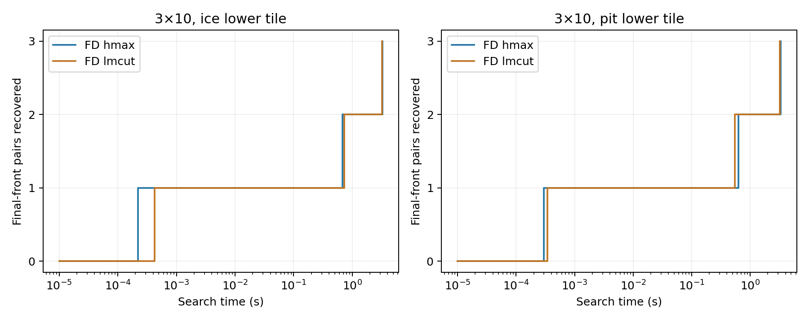
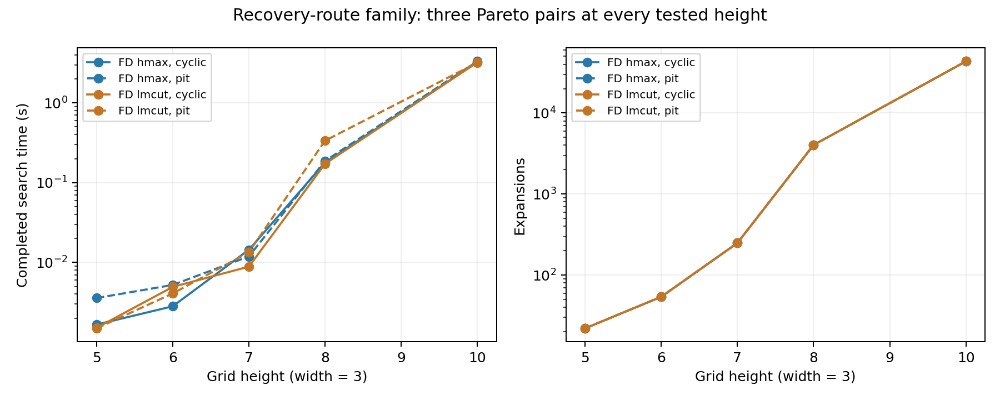

# FrozenLake recovery-route evaluation

All ten recovery-route candidates have a complete **three-point Pareto front**
in the 2026-10-15 evaluation. Both native heuristics agree, and every emitted
policy passes original-PDDL replay. The family therefore achieves the pilot's
next quality target while preserving the original FrozenLake domain.

## Scope and correctness

Execution used planner revision `67661d3`, `PYTHONHASHSEED=0`, direct FD/hmax
and FD/LM-cut, 600 seconds/job, 6,000,000 KB virtual memory/job and four workers.
No planner source, scientific definition or frozen input was changed during
execution. The smoke and pilot stages ran sequentially in detached tmux session
`frozenlake-recovery` using `/tmp/boand-recovery-20261015.sock`.

| Stage | Successful searches | Solvable instances | Replayed policies |
| --- | ---: | ---: | ---: |
| Exact-base smoke gate | 4/4 | 2/2 with each heuristic | 12/12 |
| Scaling pilot | 20/20 | 10/10 with each heuristic | 60/60 |

There were no timeouts, crashes, memory failures, malformed statistics, replay
errors or disagreements between completed heuristic fronts. The two height-five
fronts additionally match independent exhaustive enumeration. Larger fronts are
BOAND-complete and replayed, but not independently exhaustively proved.

## Quality results

Each row below applies to both heuristics. Costs are `(best, worst)`; infinity
means a proper strong-cyclic policy with unbounded worst cost.

| Height | Ice-tail front | Pit-tail front |
| --- | --- | --- |
| 5 | (1, ∞), (3, 9), (5, 7) | (2, ∞), (3, 9), (5, 7) |
| 6 | (1, ∞), (3, 11), (6, 9) | (2, ∞), (3, 11), (6, 9) |
| 7 | (1, ∞), (3, 13), (7, 11) | (2, ∞), (3, 13), (7, 11) |
| 8 | (1, ∞), (3, 15), (8, 13) | (2, ∞), (3, 15), (8, 13) |
| 10 | (1, ∞), (3, 19), (10, 17) | (2, ∞), (3, 19), (10, 17) |

For these tested heights, the pattern is a cyclic shortcut plus finite points
`(3, 2h−1)` and `(h, 2h−3)`. This is an observed pattern, not a proof for every
height. The pit changes the shortest cyclic cost without changing the observed
finite front. It does not eliminate cyclic solutions.

The two strong policies offer a two-action worst-case improvement at an
increasing best-case sacrifice. The relative worst-case improvement decreases
from 22.2% at height five to 10.5% at height ten. Thus height changes cost scales
and difficulty, but does not increase the number of choices in the tested set.
No three-entirely-finite-point front has been established.

## Quality over time

At height ten, the initial cyclic policy appears after **0.22–0.43 ms** of
search. The first strong policy appears after **0.55–0.73 seconds**, and the
third Pareto point after **3.20–3.32 seconds**. The extra search produces a
finite-worst guarantee and then another finite trade-off, rather than simply
another policy with the same costs.



First-solution coverage alone would hide almost all this work. Benchmark
evaluation should therefore retain first-proper-policy time, first-strong-policy
time, reference-front recovery over time and search completion separately.
Infinity is never interpreted as the finite display sentinel 999999 in quality
comparisons.

## Difficulty and timing

| Height | Search-time range (s) | Expansions, all four settings |
| --- | ---: | ---: |
| 5 | 0.00149–0.00357 | 22 |
| 6 | 0.00281–0.00521 | 54 |
| 7 | 0.00885–0.01439 | 249 |
| 8 | 0.172–0.336 | 4,039 |
| 10 | 3.20–3.32 | 43,416 |

Ranges cover two heuristics × two tail variants, with one observation each.
They are not repeated-measurement intervals or evidence of heuristic speedups.
For a fixed tail, both heuristics perform identical recorded search work. The
pit variant has two additional generations and one additional iteration; the
final expansion count is unchanged. At height ten the ice/pit variants generate
120,299/120,301 policies, with a peak open count of 37,594.



Search times exclude preprocessing/setup. Backend records separately show
**0.167–0.268 s** for parsing/compilation/grounding and **0.0258–0.0313 s** for
backend/heuristic setup. Per-invocation wall times were **1.21–5.23 s** and also
include process startup and other overhead, so these measurements should not
be added or compared as though their timer boundaries were identical.

The pilot job-execution window was **11.42 s**; the sum of its individual
search times was **13.94 s**, with jobs running concurrently. The complete
controller took **70.60 s** for smoke, preflight/provenance, pilot and both
policy-validation stages. These are different metrics. The current collection
provides moderate difficulty; the earlier corner family remains the available
roughly-95-second example. Different inputs/dates do not establish speedups.

## Resource observations

Machine-wide sampling ran alongside the staged evaluation. Sampled available
RAM never fell below **22.61 GiB**. Swap use remained **609,024 KB** throughout: existing swap
was present, but no increase was observed. There is no indication of memory
pressure from this evaluation.

The largest observed planner high-water RSS was **156,744 KB (153.1 MiB)**.
Only 16 of 24 planner processes were sampled; short-lived processes and final
peaks can be missed. This is a sampled observation, not an exact per-instance
peak-memory result or proof that every job stayed below that RSS. The enforced
virtual-memory limit remains a separate constraint.

## Benchmark implications

Keep this family as a three-choice quality ladder, including the independently
verified small cases and larger recovery problems. It complements the previous
two-point corner family's harder cases. Neither collection is a finalized paper
selection.

The next design target should be four or more independently verified points,
or at least three finite points with controllable relative cost gaps. Increasing
height in this family alone has not demonstrated either property. We should
develop another recovery-choice mechanism before simply generating more heights.

## Reproduction and evidence

- Definition and commands: [campaign guide](../campaigns/journal_frozenlake_recovery/README.md).
- Immutable inputs: `benchmarks/journal_tradeoffs/frozenlake_recovery/`.
- Smoke: `runs/journal_frozenlake_recovery/2026-10-15T08-07-16Z-smoke-1725c980/`.
- Pilot: `runs/journal_frozenlake_recovery/2026-10-15T08-08-01Z-pilot-c1e8d238/`.
- Controller, resource samples, preflight, validation and analysis:
  `outputs/frozenlake-recovery-2026-10-15/`.
- Phase-separated timings, quality-arrival data and summary:
  `outputs/frozenlake-recovery-2026-10-15/report/`.

Regenerate figures and numerical summaries without rerunning planners:

```bash
MPLCONFIGDIR=/tmp/boand-recovery-mpl .venv/bin/python \
  -m campaigns.journal_frozenlake_recovery.report \
  --evaluation outputs/frozenlake-recovery-2026-10-15 \
  --output outputs/frozenlake-recovery-2026-10-15/report
```

Reviewed PNG copies are committed under `docs/figures/frozenlake-recovery/`.
After regenerating, review and synchronize those copies and the figure manifest.
Raw artifacts and PDF/SVG outputs remain ignored. Generation metadata preserves
the reference knowledge at construction time; newly observed larger fronts are
recorded in this evaluation's analysis rather than rewriting frozen inputs.

Six targeted recovery-family tests passed, and the saved verification receipt
checks dry/actual selections, flags, limits, unchanged planner hashes, numerical
tables, heuristic work-count agreement and committed figure hashes. The exact
staging/monitor driver is retained as `driver.py` with the raw evaluation.
