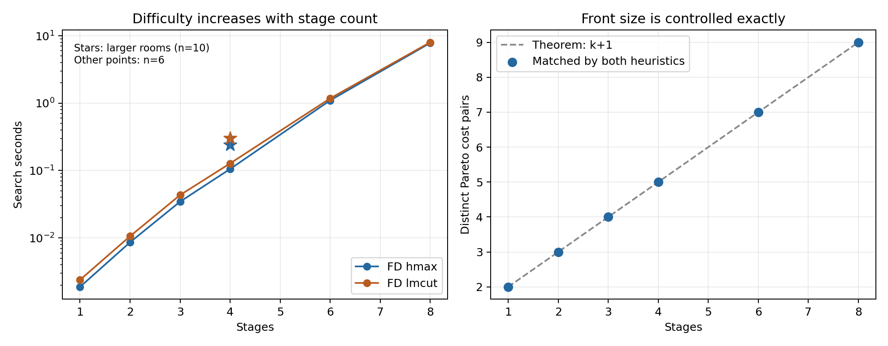
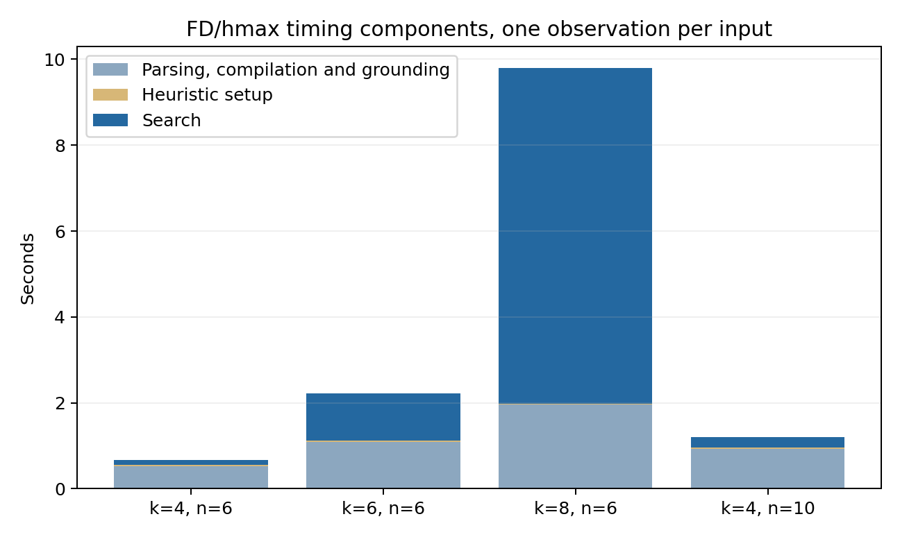

# Physical FrozenLake: composition proof and scaling probes

The 2026-10-15 follow-up establishes a general composition argument and verifies
four larger physical maps with BOAND*. **All eight searches completed with exact
reference fronts, and all 52 emitted policies passed original-PDDL replay.**
Eight stages yield nine Pareto points and took about eight seconds of search.
The original domain, ICAPS inputs and fixed journal development profiles are
unchanged. This is a bounded calibration study, not a final paper selection.

## General result

For `k >= 1` stages and even staircase size `n >= 6`, the complete front is

```
(best, worst) = ((n+11)k − 7 + (n−4)j, (2n+22)k − 14 − 8j), j=0,...,k.
```

There are `2^k` reachable strong policies, but **k+1 distinct cost pairs**;
policies with the same number of staircase choices have identical costs.
Every pair has finite worst cost. Cyclic proper policies are dominated by the
finite all-detour policy. The [composition proof](frozenlake-stage-composition.md)
handles boundary slips explicitly and explains the even-size restriction.

Increasing `k` controls front cardinality. Increasing `n` lengthens routes
without changing that cardinality. These parameters can still affect several
sources of computational difficulty simultaneously.

## Fixed larger probes

| Stages k | Room size n | Pairs | FD/hmax search s | FD/LM-cut search s | Expansions, either | Generations, either |
|---|---|---|---:|---:|---:|---:|
| 4 | 6 | 5 | 0.105 | 0.128 | 1,298 | 2,633 |
| 6 | 6 | 7 | 1.100 | 1.179 | 7,447 | 15,095 |
| 8 | 6 | 9 | 7.821 | 8.013 | 36,404 | 73,901 |
| 4 | 10 | 5 | 0.241 | 0.303 | 2,036 | 4,115 |

For eight standard stages, the front ranges from `(129,258)` to `(145,194)`;
each successive point increases best cost by 2 and decreases worst cost by 8.
The larger four-room map has the same five-point cardinality as the standard
four-room map, but its endpoints are `(77,154)` and `(101,122)`.



The one-to-three-stage points come from the preceding bounded study. Manifest
checks confirm identical planner source hashes, pinned native backend, seed,
limits and configured worker cap across both studies. There is one observation
per configuration/input: these figures show calibration behavior, not repeated
speedups or a statistically established ranking of heuristics. Both heuristics
performed the same number of expansions/generations on each new input.



Search timing excludes preprocessing, setup and replay. Native timing records
separate these components. The rectangular bounding box contains many walls:
ice-state count grows linearly with `k`, but the diagonal layout's rectangle
area grows quadratically. Thus preprocessing growth also reflects irrelevant
wall objects; the search curve is shown separately. Component bars omit process
startup and shutdown, so are not total elapsed campaign times.

## Independent correctness and validation changes

Every fixed reference was checked by complete reachable strong-policy
enumeration plus a strong-cyclic winning-region/shortest-path bound. All
available geometric actions and outcomes were compared against typed original
PDDL grounding. Enumeration confirms `2^k` strong policies for each probe,
including 256 policies at eight stages.

The independent enumerator now uses explicit stacks rather than Python
recursion. Its mathematical procedure and references are unchanged; the prior
implementation reached Python's recursion limit on eight stages. A 1,100-edge
chain and exhaustive small random-graph comparisons test the revised traversal.

For the large maps, policy replay uses a FrozenLake-specific original-PDDL
interpreter rather than full legacy Pyperplan grounding. It is restricted to
the preserved domain hash, checks original preconditions and every outcome,
and rejects missing/inapplicable actions, improper policies and cost mismatches.
It matched all 18 preceding legacy-replayed policies, including reachable-state
counts, before use on the new 52 policies. The generic replay default is unchanged.
All 11 targeted tests passed; prior physical inputs remain byte-identical.
No planner or search optimization was introduced.

## Resources and measurement limits

All profiles ran sequentially in tmux. Each had two heuristic jobs, 600 seconds
per job, 6,000,000 KB virtual memory per job, seed zero and at most four workers.
Only two planner jobs were active at once in the observed samples.

One-second sampling recorded a maximum combined planner resident memory of
**504 MiB**, maximum sampled single-planner virtual memory of
267 MiB, and at least **25.1 GiB available system memory**.
There were 32 samples. These are sampled observations, not exact process peaks;
short-lived peaks can be missed. System available memory includes other users'
activity. The observations give no indication that these probes strained RAM.

## Reproducibility and proposed benchmark use

Inputs, proof, replay and execution definitions were frozen at `74fac2b`.
The [campaign guide](../campaigns/journal_frozenlake_scaling/README.md) gives
commands, profile order and limits. Ignored evidence remains under
`outputs/frozenlake-scaling/`: dry-run manifests, `tests.log`,
`replay-crosscheck.json`, `resources.csv`, `driver.py`, `driver.log`, `status.json`,
the four `*-analysis/` folders and `report/`. The report's JSON records numerical
values and manifest/analysis hashes; the run manifests preserve source, input
and pinned backend provenance.

Run directories:

- `runs/journal_frozenlake_scaling/2026-10-15T09-19-48Z-smoke-b8a02812`.
- `runs/journal_frozenlake_scaling/2026-10-15T09-19-52Z-six-bc18dd51`.
- `runs/journal_frozenlake_scaling/2026-10-15T09-19-58Z-larger-e09fef78`.
- `runs/journal_frozenlake_scaling/2026-10-15T09-20-04Z-eight-2143723b`.

Regenerate figures, data and this report with:

```bash
MPLCONFIGDIR=/tmp/mplconfig .venv/bin/python -m campaigns.journal_frozenlake_scaling.report --analysis-root outputs/frozenlake-scaling --previous-root outputs/frozenlake-connected --output outputs/frozenlake-scaling/report
```

Reviewed PNG copies and generated-source hashes are registered in the
[figure manifest](figures/manifest.json).

Four-, six- and eight-stage standard maps now provide a useful initial range:
five, seven and nine finite Pareto points, with roughly 0.1, 1 and 8 seconds of
search in this environment. Keep them as candidate quality/difficulty levels.
A final suite should add independent domain families and repeated timing
calibration before selecting difficulty bands. No larger maps, full campaigns
or fixed-profile replacements were performed in this study.
