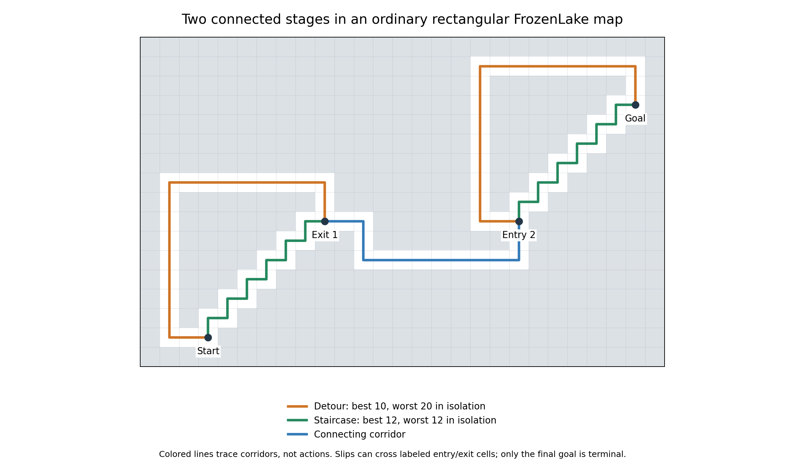
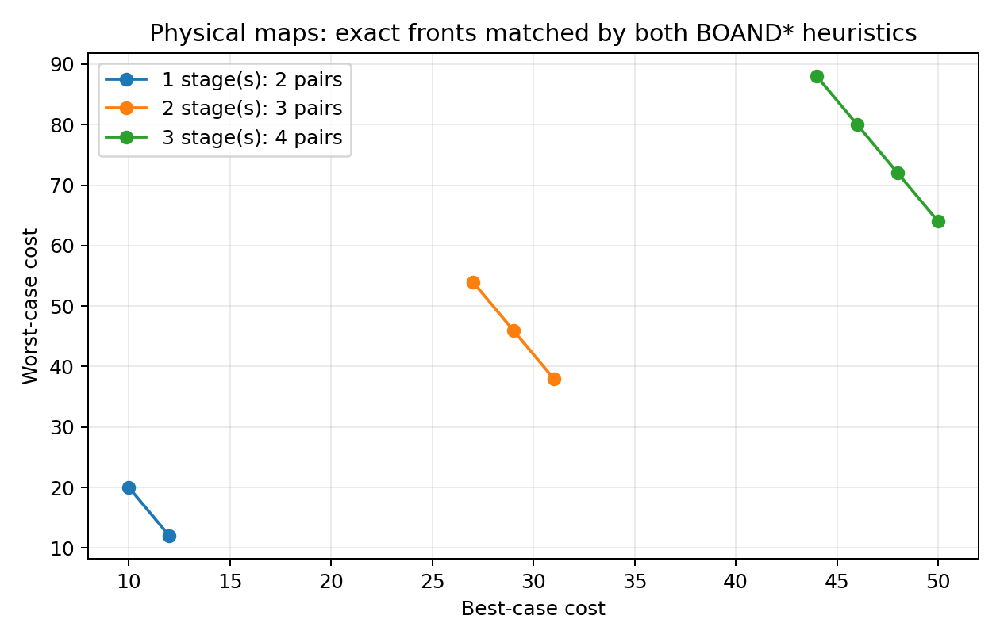

# Physical FrozenLake stages: bounded composition validation

On 2026-10-15, ordinary rectangular FrozenLake maps with one, two and three
connected stages produced **two, three and four distinct finite Pareto pairs**.
Both native heuristics matched independent complete references. All six searches
completed and all 18 emitted policies passed original-PDDL replay.

This establishes the small physical embedding that the earlier abstract study
left open. It does not prove general scaling for arbitrarily many physical
stages, and these small cases are still easy for BOAND*.

The subsequent [composition and scaling study](frozenlake-scaling-report.md)
extends this result with a general argument and verified fronts up to nine points.
The limitations below describe the initial bounded study.

## The actual map

A stage has two routes to a common exit:

- The orange detour has twenty tile-to-tile edges along four straight runs.
  Slipping one or two tiles gives best cost 10 and worst cost 20.
- The green staircase makes twelve one-tile moves. Walls beyond the next tile
  make them deterministic, giving costs (12,12).

Blue corridors connect the rooms. The original FrozenLake PDDL domain is copied
byte for byte; all adjacency is ordinary rectangular-grid adjacency. There are
no new actions, predicates, costs or goal conditions.

**Entry and exit labels mark room boundaries, not mandatory visited states.**
Unlike the abstract construction, a slip can cross one of these cells. Such
outcomes were retained and independently evaluated. Only the final goal is
terminal. A physical stage is therefore a region to traverse, rather than a
new PDDL subgoal that must be visited at one exact coordinate.

## Fronts and policy combinations

| Stages | Complete Pareto cost set |
|---|---|
| 1 | (10,20), (12,12) |
| 2 | (27,54), (29,46), (31,38) |
| 3 | (44,88), (46,80), (48,72), (50,64) |

The independent oracle finds 2, 4 and 8 reachable strong policies respectively.
Several policies have equal costs. In the two-stage example, detour–staircase
and staircase–detour both give (29,46), leaving three distinct points.
The connector contributes best/worst costs (7,14) to these combinations, after
accounting for every boundary slip. References were computed from the full
action graph; additivity was not assumed to decide expected costs.

For these checked cases the fronts fit
`(17k−7+2j, 34k−14−8j)`, for `j=0,...,k`. A proof covering all larger physical
stage counts remains future work. The previous abstract family's different
formula remains valid for that separate encoding.

## Independent validation

The geometric movement graph was compared to **all** grounded original-PDDL
actions and outcomes for every input. A separate exact oracle enumerates only
reachable stationary assignments, pruning a partial assignment when it already
contains a directed cycle. Every finite-worst policy is acyclic, so this pruning
cannot discard a finite Pareto point. Incomplete enumeration raises an error.

Cyclic proper policies are accounted for separately: a nested goal-reachability
fixed point computes the strong-cyclic winning region, and shortest paths within
that region give the minimum achievable best cost. Since every cyclic policy
has infinite worst cost, no other cyclic cost can improve that candidate. Here
the minimum best costs are 10, 27 and 44, each attained by a finite policy, so
all cyclic policies are dominated.

The oracle was also checked against full stationary-policy enumeration on 120
seeded small random graphs and targeted cyclic/dead-end cases. Four targeted
tests passed, including input regeneration, original-domain preservation and
explicit failure on enumeration limits. Planner code was unchanged.

## Measured search behavior

| Stages | Pairs | FD/hmax search ms | FD/LM-cut search ms | Expansions, either | Generations, either |
|---|---:|---:|---:|---:|---:|
| 1 | 2 | 1.87 | 2.39 | 31 | 62 |
| 2 | 3 | 8.62 | 10.59 | 160 | 324 |
| 3 | 4 | 34.54 | 43.31 | 551 | 1116 |

These are single unprofiled observations, not repeated performance comparisons.
Search timings exclude parsing, grounding, heuristic preparation and replay.
The independent replay uses the legacy preprocessing route and takes much
longer than search on these wall-heavy maps; that validation overhead is not
planner search time. No full campaign or larger stage count was run.

All three profiles ran sequentially, with two jobs each: `PYTHONHASHSEED=0`,
600 seconds/job, 6,000,000 KB virtual memory/job, at most four workers. Each
profile checks one stage count with both direct FD/hmax and FD/LM-cut.

## Provenance and next use

Inputs, independent oracle and campaign definition were frozen at `fc2384a`.
The [campaign guide](../campaigns/journal_frozenlake_stages/README.md) gives
execution, replay and regeneration commands. Ignored evidence remains in
`outputs/frozenlake-connected/`: `oracle.json`, `tests.log`, dry-run manifests,
the three `*-analysis/` folders, `driver.log`, `status.json` and `report/`.

Execution directories:

- `runs/journal_frozenlake_stages/2026-10-15T09-04-13Z-smoke-b1f9a16b`.
- `runs/journal_frozenlake_stages/2026-10-15T09-04-20Z-connected-1f37cfb0`.
- `runs/journal_frozenlake_stages/2026-10-15T09-04-57Z-extension-68465220`.

Figures are generated with
`.venv/bin/python -m campaigns.journal_frozenlake_stages.figures --analysis-root outputs/frozenlake-connected --output outputs/frozenlake-connected/report`.
Reviewed PNG copies and source hashes are registered in the
[figure manifest](figures/manifest.json).

The immediate result is a reproducible geometric quality benchmark seed.
Before expanding it into a suite, establish the general composition argument,
then vary room size separately from front cardinality to obtain useful search
difficulty. Keep these examples separate from the frozen ICAPS collection and
from the fixed journal development smoke/performance profiles.
