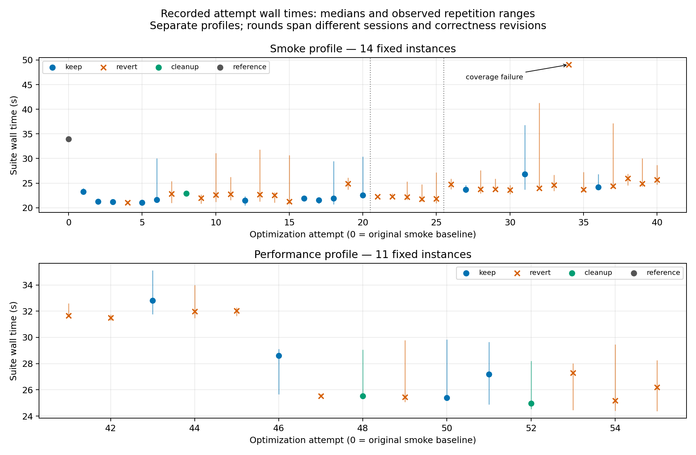
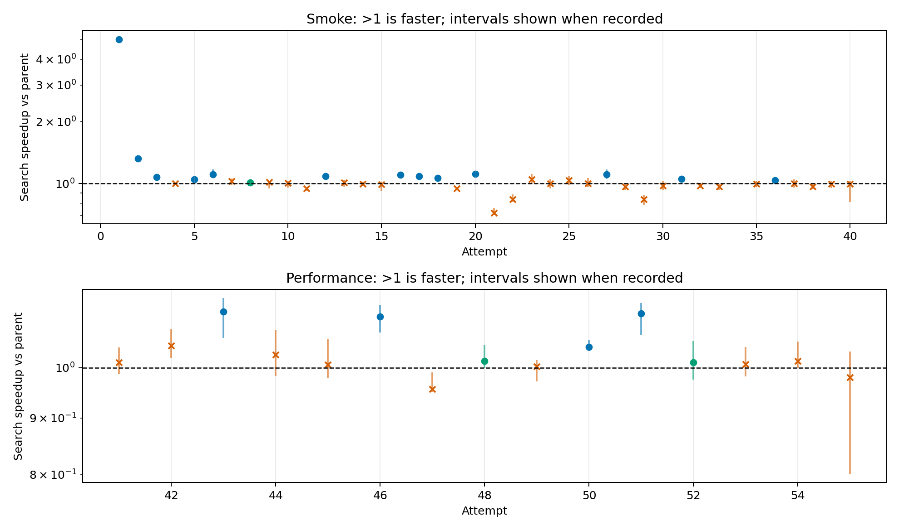
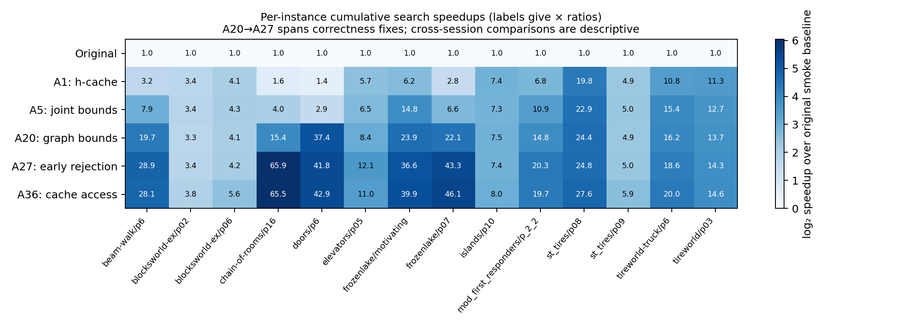
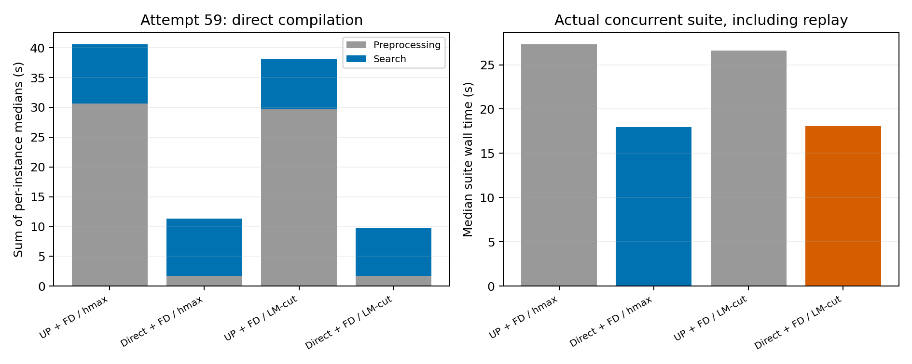
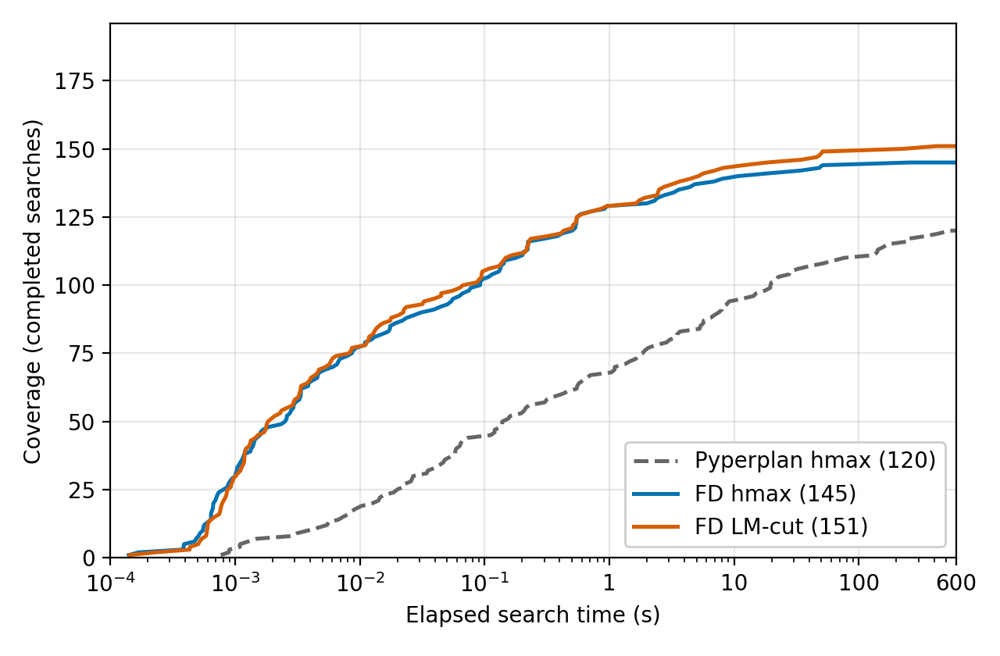

# BOAND* performance retrospective

Prepared from preserved measurements through attempt 61 and the full October 9
ICAPS evaluation. No experiments were rerun to produce this report. Raw figure
data and a portable PDF are in `outputs/performance-report/`; the detailed audit
trail remains in [performance-log.md](performance-log.md).

## Main findings

The strongest individually measured search improvement was task-local classical
heuristic caching: attempt 1 delivered **5.001x** geometric-mean search speedup
against its immediate parent. Graph-based bounds and reuse then removed repeated
trajectory work. On the original smoke selection, the retained implementation
through round 8 reached **17.522x** cumulative search speedup against the original
smoke baseline, while suite wall time fell much less, from **33.920 s** to
**24.357 s**. These cumulative timings span sessions and correctness revisions.

The harder performance profile exposed further gains in numeric graph bounds,
safe incremental reuse, and heuristic propagation. Before native migration, its
recorded cumulative speedup was **1.677x** against its own baseline. Native hmax
then added **2.256x** versus the exact parent; direct preprocessing subsequently
reduced actual suite wall time by **1.52x** in its paired hmax comparison.
These ratios refer to different experiments and must not be multiplied into a
single controlled end-to-end claim.

## Which changes drove performance?

| Mechanism | Recorded evidence | Interpretation and current relevance |
| --- | --- | --- |
| Classical heuristic memoization (1) | 5.001x search; suite 33.920 to 23.226 s | Repeated policies revisit the same states. Bounded task-local caching avoids recomputing state heuristics and is retained with native heuristics. Largest early isolated gain. |
| Cached ancestor walks (2), outcome reuse (6, 20), skipped unchanged comparisons (12) | Parent gains 1.321x, 1.109x, 1.113x and 1.088x respectively | Remove repeated traversal and outcome construction. Early ancestor machinery was subsequently replaced; these historical gains are not four additive contributions in current code. Task-local outcome reuse remains relevant. |
| Grouped successor caching (3), joint frontier bounds (5), dead-end pruning (27, 31) | Parent gains about 1.073x, 1.047x, 1.107x and 1.052x | Share immutable results, scan the frontier once, and reject doomed actions before expensive copying/extension. These reduce work per policy without changing measured work counts in their fixed-suite comparisons. |
| Graph analysis and numeric costs (16–18, 46) | Round 4 retained batch: 1.422x; numeric best distances: 1.113x on harder profile | Replace repeated path-based bound work with BFS/Kahn graph passes and direct numeric values. These are central structural improvements in current policy evaluation. |
| Safe partial graph reuse (43) | Final recorded aggregate 1.125x; interval 1.065–1.157x | Reuse parent bounds when new edges provably cannot change them. Retested on harder inputs after being inconclusive on smoke. Doors benefits particularly strongly. |
| Pyperplan hmax propagation (50, 51) | 1.045x and 1.120x parent gains | One operator cost per activation and the last settled precondition reduce Python heuristic work. Still useful on the legacy backend; current native hmax uses FD's implementation instead. |
| Native FD execution + heuristics (56) | hmax 2.256x search (2.229–2.310x), all work rows unchanged | C++ transitions/heuristics remove Python overhead. This milestone is a batch; the evidence does not isolate transition speed from heuristic speed. LM-cut provides a new guidance option. |
| FD grounding with cleanup (58) | LM-cut 1.079x search; hmax inconclusive; suite roughly unchanged | Removes unreachable operators, preserves reachable outcomes, and reclaims translation temporaries before search. Do not call the standalone cleanup a proven speedup. |
| Direct negative-condition compiler and lazy imports (59) | hmax suite 27.295 to 17.969 s; LM-cut 26.619 to 18.052 s | Avoids UP import/parse/compile/write overhead. Large setup/end-to-end gain; most of the benefit is outside search. |

The parent comparisons are local causal evidence on their recorded selections;
they do not estimate each component's share of the final full-suite speedup.
Retained cleanup and memory improvements are distinguished from timing wins:
policy slots (8), unused selector heap removal, one-pass successor classification
(48), and fused numeric bound updates (52) were retained for explicit engineering
benefits with weak or absent independent timing evidence.

## Correctness-driven changes

BFS shortest best bounds on cyclic graphs correct an overestimate in the original
planner. Closed-policy properness now uses reverse goal reachability rather than
trajectory enumeration: after building the graph, all reachable states must be
able to reach a goal, using graph traversal linear in vertices plus edges.
The cyclic best-bound correction also delivered **1.245x** search speedup
(1.216–1.255x) versus its fresh parent, without a robust suite-wall win.
Properness is both a better implementation and a correctness fix; that correction's
recorded smoke ratio was 1.014x with an interval spanning one, so it is not
presented as a measured performance win. Initially satisfied goals now yield the
correct empty policy with zero cost. These fixes are retained independently of
timing and prevent interpreting old behavior as the correctness oracle.

## Recorded attempt timings

The top panel contains attempts 1–40 on the fixed **14-instance smoke** profile;
the bottom contains attempts 41–55 on the fixed **11-instance performance**
profile. Dots are recorded suite medians; vertical lines are observed repetition
min/max ranges where available and compatible, not confidence intervals.
Rejected candidates are crosses. Attempt 34's failed coverage is explicitly
marked; its wall time is not a successful measurement. Refinement variants are
preserved in the CSV but omitted from the numeric attempt axis.

These timelines are descriptive. They span different sessions, load and semantic
versions. Vertical markers after 20 and 25 locate the cyclic-bound and properness
correctness boundaries. A lower suite time alone is insufficient evidence to
keep a change: setup, imports, process launch and policy replay dilute search
improvements, and contention causes wall-time variability. Migration smoke checks
are often single correctness runs; they are not joined onto repeated medians.

Search speedup is the geometric mean of per-instance median parent/candidate
ratios. Intervals are the recorded whole-run bootstrap intervals where available,
not new estimates. The parents follow retained history, not necessarily the
previous numbered attempt: a reverted experiment does not become the next
baseline. Failed searches have no aggregate speedup. The first large caching win
stands out; many later changes cluster around one and were reverted.

The heatmap uses the same fourteen smoke identities at selected historical
milestones. It shows broad improvements with especially large gains in cases
that formerly repeated heuristic or graph work. It crosses correctness versions
and sessions, so it visualizes cumulative recorded progress rather than claiming
arbitrary-task semantic equivalence. Attempt 36 uses its initial three-run record;
the separately reported round-8 cumulative ratio uses five retained repetitions.

## Search versus preprocessing in migration

Attempt 59 used fresh controls and three repetitions per configuration. Summed
median preprocessing drops from **30.601 to 1.730 s** for hmax and **29.703 to
1.725 s** for LM-cut; summed search changes only from **9.949 to 9.618 s** and
**8.447 to 8.037 s**. Phase sums are across independent processes and are not
concurrent suite wall times. Both paired configurations use the same phase
accounting, including cold compiler imports; earlier migration phase timers did
not, so comparisons with their preprocessing sums would be misleading.

Native LM-cut is not universally faster than native hmax. On the fixed harder
profile it cuts Elevators expansions from 46,819 to 461 but is expensive on
Beam-walk. In the full suite it completes more searches, while its common-case
search geometric mean is slower. More informed estimates can save enough search
to outweigh evaluation cost on difficult instances, without winning every case.

## Full-suite outcome

The local October 7 Pyperplan/hmax run completes **120/196** searches and has
policies for **114** instances. Current FD hmax completes **145**, with **137**
independently verified solved instances (including supplemental Beam-walk replay);
FD LM-cut completes **151**, solving **145**. Neither loses an earlier completed
or policy-bearing instance. Search speedups are **41.1x** and **35.6x** over 119
common completed, equal-cost instances. The earlier run predates all journal
optimization rounds, not just native migration. Its policies were not revalidated
here, and 79 completed records lack exit codes but have final completion markers.

The coverage plot follows the paper: completed searches including unsolvable
cases, versus per-instance elapsed search time, excluding preprocessing. Both
new configurations reach the earlier final coverage in under one second per
instance. This does not mean the entire experiment executes in one second.

The old full run used 8 GB/two workers; current runs use 6 GB/four workers, all
with 600-second per-instance limits. Forty-eight hmax jobs and forty-one LM-cut
jobs hit their individual memory limits. Memory is now a principal coverage
constraint. New full runs are one measurement per case, not repeated controlled
estimates; speedup ratios cannot isolate migration or remove environmental drift.
The published archive is a separate reference (124 completed, 118 policy-bearing).

## Lessons from rejected approaches and next bottlenecks

Parent-linked strategies, broader incremental graph updates, alternate queue
comparisons, trajectory prefix sharing and dense graph indexing did not establish
sufficient repeatable benefit. Attempts 60–61 also rejected Python native-state
handles (about 22% slower despite a small memory reduction) and paired Boolean
SAS encoding (near-neutral timing, no useful memory reduction). Correctness
checks and rejected evidence are preserved. These results favor selective reuse
with simple data structures over adding bookkeeping across every extension.

Further performance work should target policy memory/copying on full-suite
failures and graph/bound work on difficult retained cases. Independent replay
preprocessing also needs scaling: UP negative-condition compilation materializes
more than 33 million potential edge fluents for Beam-walk p11, whereas the
independent domain-specific replay verifies its policy in about 107 MiB.
This is a validator limitation, separate from search performance.

## Reproduction and evidence

Generate figures, exported CSVs/metadata and the portable PDF with:

    MPLCONFIGDIR=/tmp/boand-report-mpl PYTHONHASHSEED=0 .venv/bin/python -m campaigns.journal_icaps_comparison.performance_report

Input sources: `outputs/performance/round1` through `round12`, migration evidence
under `outputs/fast-downward*`, the two full run manifests and the supplemental
review under `outputs/full-review`. Figure data: `attempts.csv`,
`heatmap-data.csv`, `migration-phase-data.json`, and `report-metadata.json` in
`outputs/performance-report/`. Full coverage data remain in
`outputs/prebranch-comparison/coverage/`. The performance log links the exact
candidate/parent revisions, raw runs, work-count checks and keep/revert decisions.

Reviewed PNG copies referenced by this report are committed under
`docs/figures/performance/` and `docs/figures/icaps-comparison/`. After
regeneration, review and synchronize those copies and `docs/figures/manifest.json`.
