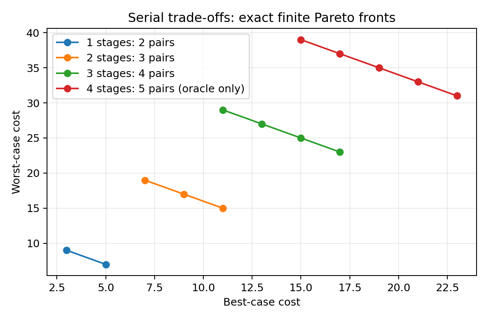

# Scaling Pareto-front size through serial composition

The bounded study on 2026-10-15 establishes an abstract unit-cost FOND family
with exactly `k+1` finite Pareto cost pairs for `k` stages. It does **not** yet
establish such a family of ordinary rectangular FrozenLake maps.

## Construction and completeness

Each stage offers fast `(3, 3+6d)` or safe `(3+2d, 3+4d)` best/worst costs,
where positive integer `d` controls spacing. Outcomes follow private forced
paths to a shared exit; consecutive stages have one deterministic connector.
For `j` safe decisions among `k` stages, the costs are

```
(best, worst) = (4k − 1 + 2dj, (4 + 6d)k − 1 − 2dj), j = 0,...,k.
```

Increasing `j` improves worst cost and worsens best cost by the same amount.
Every pair has the same sum, so all `k+1` are nondominated. All are strong
policies. The construction has size proportional to `kd`.

The original FrozenLake domain is unchanged, but the diagnostic inputs use
non-geometric directional adjacency, including multiple neighbors in one
direction. They must remain separate from physical lake benchmarks. The
encoding's extra reversal actions produce reachable cycles with infinite worst
cost and cannot improve the globally minimum best cost; the finite all-fast
policy dominates them. Alternating path axes prevents other backward shortcuts.
Every solution visits stage exits in order. The
[campaign guide](../campaigns/journal_serial_tradeoffs/README.md) records the
full construction and completeness argument.



## Independent and planner validation

Independent grounding evaluates the original PDDL preconditions and outcomes,
including extra actions outside the intended construction. Exhaustive stationary
policy enumeration verified these fronts:

| Stages | Gap | Complete Pareto front | Assignments checked |
|---|---|---|---|
| 1 | 1 | (3,9), (5,7) | 8 |
| 2 | 1 | (7,19), (9,17), (11,15) | 64 |
| 3 | 1 | (11,29), (13,27), (15,25), (17,23) | 512 |
| 4 | 1 | (15,39), (17,37), (19,35), (21,33), (23,31) | 4096 |
| 2 | 2 | (7,31), (11,27), (15,23) | 64 |

BOAND* with direct FD/hmax and FD/LM-cut matched every expected pair on the
first three stage counts and the gap-two control: **8/8 completed searches,
24/24 policies replayed successfully against original PDDL**. Search times
were approximately 0.9–5.1 ms. Four stages were checked by the independent
oracle only. Larger counts follow from the proof and have not been measured.
These single observations characterize correctness, not repeatable speedups.
Three targeted tests passed, including deterministic regeneration and domain
byte identity. No planner code was changed.

## Physical embedding trial

Attaching an exit corridor to one ordinary rectangular recovery gadget yielded
`(11,23)` and `(13,21)`, both independently replayed, in about 3.2 ms of search.
The two-room rectangular composition hit its **6,000,000 KB virtual-memory
limit**, returned no policies, and did not complete. Its front is unknown;
this is neither unsolvability nor evidence of a particular front size.

Opening ports changes available nondeterministic movements, so additivity of
the abstract stages cannot simply be assumed for rectangular maps. These two
trials do not prove geometric composition impossible. A useful next step is a
smaller independently enumerable physical interface gadget, or a separately
named graph-navigation benchmark explicitly based on the proven construction.
The abstract cases are currently too easy to serve as performance benchmarks.

## Reproducibility and scope

Inputs and generator were frozen at revision `9617acb`. Both profiles used
600 seconds/job, 6,000,000 KB/job, at most four workers and `PYTHONHASHSEED=0`;
the profiles ran sequentially. The prepared larger pilot was not launched.
Raw evidence is ignored and retained at:

- `outputs/serial-tradeoffs/oracle.json` and `tests.log`.
- `outputs/serial-tradeoffs/smoke-analysis/` and `embedding-analysis/`.
- `runs/journal_serial_tradeoffs/2026-10-15T08-38-12Z-smoke-0ee9c363`.
- `runs/journal_serial_tradeoffs/2026-10-15T08-38-23Z-embedding-a8c17a12`.
- `outputs/serial-tradeoffs/report/generate.py` and `finite-fronts.png`.

The reviewed figure copy and its source/hash are registered in the
[figure manifest](figures/manifest.json). Existing ICAPS inputs, campaign
selections and planning semantics are unchanged.
